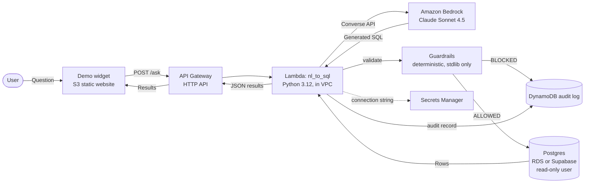

# Governed NL-to-SQL Analytics Layer on AWS

Ask a question in plain English, get an answer from a Postgres database —
without ever letting the language model run arbitrary SQL.

Most NL-to-SQL demos hand the model a database connection and hope for the
best. In a regulated environment that is a non-starter: a probabilistic model
must never be able to `DROP` a table, `SELECT` from a table it was never
shown, or dump a million rows. This project treats the model as an untrusted
downstream service and puts three independent, deterministic layers between
it and the data:

1. **Guardrails** — every generated statement is validated (single `SELECT`,
   allowlisted tables and columns, no mutating keywords, capped `LIMIT`)
   before it is allowed near the database.
2. **Least-privilege role** — the Lambda connects as `analytics_ro`, a
   Postgres user with `SELECT` and nothing else.
3. **Read-only transaction** — every execution starts with
   `SET TRANSACTION READ ONLY`, with a 10-second statement timeout.

Every request — allowed, blocked, or errored — is written to a DynamoDB
audit log before the response is returned, so there is a complete record of
what was asked, what SQL was generated, what the guardrails decided, and how
many rows came back.

## Architecture



See [docs/architecture.md](docs/architecture.md) for the full write-up,
[docs/guardrails.md](docs/guardrails.md) for the guardrail rules, and
[docs/audit-log.md](docs/audit-log.md) for the audit schema.

## What's in the repo

```
.
├── README.md
├── LICENSE
├── terraform/                  # Modular Terraform (AWS provider ~> 5.0)
│   ├── main.tf                 # Provider, default VPC data sources, tags
│   ├── variables.tf            # project, environment, region, model, DB creds
│   ├── outputs.tf              # API URL, widget URL, table/secret names
│   ├── api.tf                  # HTTP API: POST /ask -> Lambda
│   ├── lambda.tf               # Lambda, psycopg2 layer, VPC endpoints
│   ├── dynamodb.tf             # Audit table (PAY_PER_REQUEST + timestamp GSI)
│   ├── rds.tf                  # Postgres 16, db.t3.micro, encrypted, private
│   ├── secrets.tf              # DB connection string in Secrets Manager
│   ├── s3.tf                   # Static hosting for the demo widget
│   ├── iam.tf                  # Least-privilege Lambda role
│   └── terraform.tfvars.example
├── src/lambda/
│   ├── nl_to_sql.py            # Handler: Bedrock -> guardrails -> Postgres -> audit
│   ├── guardrails.py           # Deterministic SQL validation (stdlib only)
│   ├── db.py                   # Secrets Manager + read-only Postgres execution
│   ├── schema.py               # Retail schema (shared by prompt + guardrails)
│   └── requirements.txt        # psycopg2-binary (boto3 comes from the runtime)
├── sql/
│   └── retail_schema.sql       # stores, products, inventory, customers, sales + seed data + analytics_ro
├── frontend/
│   ├── index.html              # Demo widget
│   ├── app.js                  # Calls POST /ask, renders SQL / verdict / results
│   └── config.js               # The one config value: API_BASE_URL
├── scripts/
│   ├── build_layer.sh          # Builds the psycopg2 Lambda layer zip
│   ├── deploy.sh               # Layer + terraform apply + widget upload
│   ├── seed_db.sh              # Loads the schema, switches the secret to analytics_ro
│   └── demo.sh                 # Curls the API with valid + blocked questions
├── tests/
│   └── test_guardrails.py      # 30 stdlib unittest tests for every guardrail rule
└── docs/
    ├── architecture.md
    ├── guardrails.md
    └── audit-log.md
```

## Guardrail rules (summary)

| Rule | Behaviour |
|---|---|
| Statement type | `SELECT` or `WITH ... SELECT` only; a single statement (no stacked queries). |
| Blocked keywords | `DROP`, `DELETE`, `UPDATE`, `INSERT`, `ALTER`, `TRUNCATE`, `GRANT`, `REVOKE`, `COPY`, `CREATE`, `INTO`, `MERGE`, `CALL`, `DO`, `VACUUM`, `ANALYZE`, `COMMENT`, `SECURITY`. String literals are stripped before scanning, so a product named `'DROP'` is fine. |
| System catalogs | `information_schema` and `pg_catalog` are forbidden, including via `UNION`. |
| Tables | Must exist in the schema (`stores`, `products`, `inventory`, `customers`, `sales`) or be a CTE defined in the query. |
| Columns | Must exist in the schema. `table.column` references are checked against that table; aliases are recognised. |
| Result size | A missing `LIMIT` gets `LIMIT 100` appended; a larger `LIMIT` is capped at 100. |

Full rules, ordering, and known limitations: [docs/guardrails.md](docs/guardrails.md).

## Audit log (summary)

One DynamoDB item per request: `question_id`, `created_at`,
`question`, `generated_sql`, `guardrail_verdict` (`ALLOWED` / `BLOCKED` /
`ERROR`), `guardrail_reason`, `model_id`, `row_count`, `execution_ms`.
Details and sample items: [docs/audit-log.md](docs/audit-log.md).

## Demo questions

Allowed (run against the seed data):

- "What are the top 5 products by total sales revenue?"
- "Which store made the most revenue in October 2026?"
- "How many Gold loyalty customers do we have?"
- "Show me inventory below 10 units by store."

Blocked by the guardrails:

- "Delete all sales from last year" — the model generates a `DELETE`, which
  is not a `SELECT`.
- "How many employees work in each department?" — there is no `employees`
  table; the model hallucinates one and the table allowlist blocks it.

The blocked cases depend on the model generating the disallowed SQL — the
questions are phrased to elicit it, and in practice it does. The
deterministic behaviour of the guardrails does not depend on the model at
all and is covered by the test suite.

## Prerequisites

- An AWS account with Bedrock model access enabled for the configured model
  (Bedrock console → Model access — a one-time, manual step; it cannot be
  done in Terraform).
- Terraform >= 1.5, AWS CLI v2 (authenticated), `jq`, `psql`, Python 3.12,
  `zip`.
- The default model is `anthropic.claude-sonnet-4-5-20250929-v1:0`
  (Claude Sonnet 4.5). Change it with the `bedrock_model_id` Terraform
  variable; the IAM policy scopes `bedrock:InvokeModel` to exactly the
  configured model. If you use a cross-region inference profile instead,
  use its `us.anthropic...` id and add the inference-profile ARN to the
  policy in `terraform/iam.tf`.

## Deploy

```bash
# 1. Set the DB admin password (never commit it).
export TF_VAR_db_password='a-strong-password'

# 2. Deploy everything: layer build, terraform apply, widget upload.
./scripts/deploy.sh
```

`deploy.sh` prints the API URL and the widget URL. Then load the dataset:

```bash
# 3. Load the schema + seed data, and switch the Lambda to the read-only user.
# Run from inside the VPC (the RDS instance is not publicly accessible),
# e.g. EC2 or CloudShell in the same VPC, or through a bastion/SSM tunnel.
PGUSER=nl_sql_admin PGPASSWORD='a-strong-password' RO_PASSWORD='another-strong-password' \
  ./scripts/seed_db.sh
```

`seed_db.sh` needs `PGHOST` (defaults to the Terraform `db_endpoint`
output), `PGUSER`, `PGPASSWORD`, and `RO_PASSWORD`. It creates the
read-only `analytics_ro` user and updates the Secrets Manager secret to the
`analytics_ro` connection string, so from then on the Lambda connects as
the least-privilege user. Terraform will not revert that switch (the secret
has `lifecycle { ignore_changes = [secret_string] }`).

## Run the demo

- **Widget:** open the widget URL printed by `deploy.sh`. Type a question
  or click a sample question. The page shows the generated SQL, the
  guardrail verdict, and the results table.
- **CLI:** `./scripts/demo.sh` curls the API with one valid question, one
  that gets blocked, and one referencing an unknown table.
- **Direct API call:**

```bash
API_URL=$(terraform -chdir=terraform output -raw api_url)
curl -s -X POST "$API_URL/ask" -H "Content-Type: application/json" \
  -d '{"question": "What are the top 5 products by total sales revenue?"}'
```

## Run the tests

```bash
python3 -m unittest discover -s tests -v
```

30 tests, standard library only — no AWS access or database needed.

## Using an existing Supabase Postgres instead of RDS

The Lambda reads its connection string from Secrets Manager, so the database
can be any Postgres. To use Supabase (or any existing Postgres):

1. Load `sql/retail_schema.sql` into it (with `psql` and a `RO_PASSWORD`).
2. Update the Secrets Manager secret (`{project}-{environment}/db-connection`)
   to `{"connection_string": "postgres://analytics_ro:<password>@<host>:5432/<db>"}`.
3. No code or Terraform change is needed. You can skip the RDS instance by
   removing `terraform/rds.tf` — but note `secrets.tf` builds the initial
   secret value from the RDS endpoint, so point it at your Supabase
   connection string instead.

## Costs (approximate, us-east-1)

Roughly $30/month while deployed, mostly the RDS `db.t3.micro` (~$13) and
two VPC interface endpoints (~$7 each). Bedrock is pay-per-token (pennies
per demo question), DynamoDB is on-demand, and API Gateway, Lambda, S3, and
Secrets Manager are within or near free-tier levels at demo volume. Run
`terraform destroy` when you are done.

## Cleanup

```bash
terraform -chdir=terraform destroy
```

This removes the API, Lambda, DynamoDB table, RDS instance, secret, and S3
bucket (the bucket has `force_destroy` so its objects go too). Secrets
Manager schedules a 30-day recovery window on the secret by default; use
`--force-delete-without-recovery` in the console if you need it gone
immediately.

## What is and isn't automated

Automated by `deploy.sh` + `seed_db.sh`: the layer build, all AWS resources,
the widget upload with the real API URL, the schema load, and the switch to
the read-only DB user.

Not automated, by design:

- **Bedrock model access** — enabling a model in an account is a console
  action; Terraform cannot do it.
- **Network access for seeding** — the RDS instance is private, so
  `seed_db.sh` must run from inside the VPC (or through a tunnel).
- **The widget is public and the API has no authorizer.** That is a
  deliberate demo trade-off: the widget contains no secrets, and the worst
  case for an unauthenticated caller is a read-only query against the demo
  dataset. For a real deployment, put the widget behind CloudFront with
  Origin Access Control, restrict the API CORS origins, and add an
  authorizer.

## License

MIT — see [LICENSE](LICENSE).
