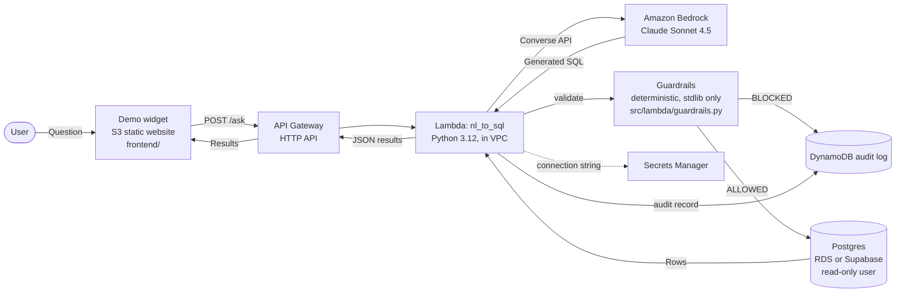

# Architecture

## Diagram

## Components

| Component | What it is | Where it lives |
|---|---|---|
| Demo widget | Static HTML/JS page: question box, sample questions, SQL + verdict + results panels | `frontend/`, hosted on S3 |
| HTTP API | API Gateway v2, one route: `POST /ask` | `terraform/api.tf` |
| Lambda `nl_to_sql` | Orchestrates: prompt Bedrock, validate SQL, execute read-only, audit | `src/lambda/nl_to_sql.py` |
| Guardrails | Deterministic SQL validation, stdlib only | `src/lambda/guardrails.py` |
| Bedrock | Claude Sonnet 4.5 via the Converse API, temperature 0 | Model id is a Terraform variable |
| Postgres | Retail dataset (`stores`, `products`, `inventory`, `customers`, `sales`) | RDS (Terraform) or an existing Supabase Postgres |
| Audit log | DynamoDB, one item per question, PAY_PER_REQUEST, timestamp GSI | `terraform/dynamodb.tf` |
| Secrets | DB connection string, JSON `{"connection_string": ...}` | `terraform/secrets.tf` |

## Request flow

1. The widget POSTs `{"question": "..."}` to `/ask`.
2. The Lambda builds a prompt embedding the retail schema and calls Bedrock
   Converse (temperature 0, max 1024 tokens).
3. The generated SQL is passed through `guardrails.validate_sql`. If it is
   blocked, an audit record with verdict `BLOCKED` is written and the API
   returns 403 with the reason and the generated SQL — the database is never
   touched.
4. Allowed SQL runs against Postgres in a read-only transaction
   (`SET TRANSACTION READ ONLY`) with a 10-second statement timeout, as the
   `analytics_ro` user, which holds only `SELECT` privileges.
5. An audit record with verdict `ALLOWED`, the executed SQL, and the row
   count is written to DynamoDB, and the results are returned as JSON.

## Trust boundaries

The design assumes the LLM output is **untrusted**. The prompt asks the
model to generate safe SQL, but nothing depends on the model complying:
enforcement is entirely deterministic and sits in three independent layers.

1. **Guardrails** (`guardrails.py`) — the statement must be a single
   `SELECT`/`WITH` against allowlisted tables and columns, with no
   mutating keywords and a capped `LIMIT`.
2. **Database role** — the Lambda connects as `analytics_ro`, which has
   `SELECT` and nothing else. Even a guardrail bypass could only read.
3. **Read-only transaction** — every execution starts with
   `SET TRANSACTION READ ONLY`, so a write would fail at the database even
   if the role somehow allowed it.

## Networking

The Lambda runs inside the account's default VPC so it can reach the
private RDS instance. It has no internet egress: Bedrock, Secrets Manager,
and DynamoDB are reached through VPC endpoints (interface endpoints for
Bedrock Runtime and Secrets Manager, a gateway endpoint for DynamoDB). The
RDS security group allows Postgres traffic only from the Lambda's security
group.

## What is deliberately not in the architecture

- **No authorizer on the API.** The demo is public by design; the README
  notes that a real deployment should add one.
- **No CloudFront in front of the widget.** The S3 website endpoint is
  enough for a demo; the README notes the production alternative.
- **No caching of Bedrock responses.** Every question is a fresh model call,
  so the audit log reflects exactly what was generated each time.
